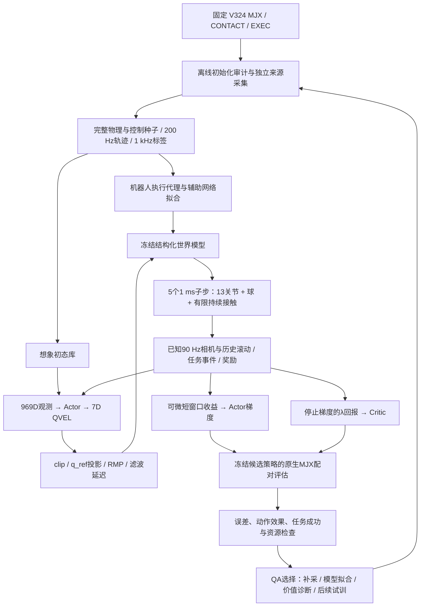

# WMJ-V1 世界模型实现、实验状态与跨机器交接

整理日期：**2026-11-23，Asia/Shanghai**。最近完成的 WMJ 实验：**2026-11-12，a52**。
本文是接手说明，不是新实验授权，也不表示模型已经训练达标。

配套文件：[技术附录与完整索引](WMJ_V1_HANDOFF_APPENDIX_20261123.md) ·
[文件与哈希清单](WMJ_V1_HANDOFF_INVENTORY_20261123.json) ·
[源码提交候选清单](WMJ_V1_HANDOFF_SOURCE_PATHS_20261123.txt) ·
[独立资产传输清单](WMJ_V1_HANDOFF_ASSET_PATHS_20261123.txt)。

## 0. 接手时先看这些结论

1. **主版本永久固定为 WMJ-V1**。用户明确禁止自动迭代到 V2。新增实验用独立 `run_id`、checkpoint SHA-256、`model_revision` 区分，不覆盖旧实验。
2. 保留 V324 的真实 MJX 仿真、碰撞参数和 EXEC 优化。世界模型是训练端的结构化可微近似；不能为了降低拟合误差而改变教师物理。
3. 已实现：全状态采集/恢复、全域候选初始化、时间戳对齐的球/拍历史、机器人执行代理、软接触基项与辅助预测、纯想象 Actor/Critic、持续环境、课程状态机、冻结 MJX 验证，以及多个有预算的短实验。
4. **尚未完成 S01 的 16 拍目标，更未完成 S02–S05、全域 90% 成功率、整体加速证明或实机部署。** 代码存在、单元测试通过、模型局部误差下降，不等于这些目标完成。
5. 当前诊断组合：969 维显式历史 Actor；全 13 关节执行代理；完整法向/切向软接触基项；冻结 47→6 辅助网络 u12288；39 维接触残差关闭；取消拍面角度限制的私有候选；局部投影精度修复；候选出球速度奖励 XY=1.23、Z=0.43。**该组合未替换默认合同。**
6. 最近拟合只更新 Critic，Actor 保持 FP32 u30。Critic 已到 1656 步，但留出集状态区分能力仍不合格。a52 完成了输入尺度、分布、梯度敏感性诊断，没有进一步训练。
7. **下一项尚未回答的 QA**：是否对困难来源 401 与已有训练近邻 527/511 做完整状态、击球事件、失败时间和奖励分项冻结对照。预算提议 ≤512 KiB；未获回答，不能自行执行。
8. 2026-11-23 本次只授权整理交接文档。新机器上的 Codex 应先读文档、核验迁移、汇报缺项，再通过对话框确认下一实验；不能直接执行旧 launcher。

## 1. 阅读顺序与信息优先级

从仓库根目录开始，依次读取：

1. `AGENTS.md`：贡献、来源、实验和硬件规则。
2. 本文：用户本会话已确认的 WMJ 特例、最新状态与接手顺序。
3. `TRAINING_CURRICULA.md`：检索 `WMJ-V1`、`a43` 到 `a52`；不要把 FPLC 的阶段当作 WMJ 阶段。
4. `pingpong_controller/tools/rl_2real/WMJ_TRAINING_PROTOCOL.md`。
5. `pingpong_controller/tools/rl_2real/WMJ_V1_CONFIG.json`，再看所选实验 plan、launcher、实际入口代码。
6. 本文引用的 verification、result、checkpoint manifest；以实际 SHA-256 和数值证据核验。
7. `WMJ_V1_CANDIDATES_AND_DIFFERENTIABILITY.md`：两项未来候选和可微必做项。其“恢复后的当前阶段”停留在 a50，**属于历史记录，不覆盖 a52**。
8. `STABLE_JUGGLING_SIM2REAL_ARCHITECTURE_AND_CODEX_PROMPT.md`：未来部署设计，不是启动硬件或转入另一课程的授权。

本文中的缩写：

| 缩写 | 仓库相对路径 |
| --- | --- |
| `SIM` | `pingpong_controller/tools/rl_sim` |
| `WM` | `pingpong_controller/tools/rl_sim/world_model` |
| `CFG` | `pingpong_controller/tools/rl_2real/WMJ_V1_CONFIG.json` |
| `OUT` | `pingpong_controller/outputs/rl_sim/wmj_v1` |
| `DOC` | `pingpong_controller/tools/rl_2real` |

原始用户附件位于旧机器的 `/home/yangzhe/.codex/attachments/0ef630db-6dda-4add-a885-394e677d5852/pasted-text-1.txt`，SHA-256 为 `20e48e2b957485a63ccaa74ad761405380f582507b31b1a6b30429b78d8f9593`。其核心要求已在本文整理。附件中的早期 73D、35D 执行代理、固定分支比例等被后续 QA 明确修订，以本文和最新实验合同为准；迁移附件可作为额外历史证据，但不应把个人 Codex 目录整体同步给项目。

### 1.1 不要用一个旧 status 字段概括整个项目

CFG 保留了历次实验块及其原始状态。例如：

- `domain.roll_pitch_limit_deg=2` 是保留的基础合同；后续私有候选取消角度限制。
- `imagination.target_critic_ema=.01` 是基础配置；最近 Critic 试验使用 .05。
- `world_model.solver_acceleration_auxiliary.enabled_in_world=false` 保留早期独立辅助试验默认状态；当前完整基项候选通过专用组合路径接入辅助预测。
- `imagination_implementation.remaining/status` 含早期未更新的阶段描述；最新 `critic_*` 块、plan、verification 才说明后续试验的完成情况。
- a51 的 `verification` 指向中断证据，完成结果在 `final_verification`。
- 某些模块 docstring 保留“独立诊断”时的描述；实际调用链见 `full_prior_world.py`、`normal_coupling.py`、`corrected_candidate.py` 及本轮 plan。

不得为了“整理一致”把旧实验块全部改成新候选，也不得通过批量置 `authorized=true` 重新打开已结束试验。

## 2. 用户确认的约束和规范

### 2.1 QA、版本与授权

- 用户要求用**对话框实时提问，等回答后再继续**。改变网络输入、奖励、约束、训练阶段、更新预算、存储预算时先提问。新会话可使用 `request_user_input_async`；若不可用，明确提问并停止依赖该答案的工作。
- 普通低风险实现细节可在已批准阶段内完成；不要把 FP32 的微小舍入差异反复升级为合同问题。用户明确接受 qpos 约 3.3e-9、qvel 约 9.2e-7 一类无实质影响的差异；离散接触/终止/投影分支变化仍必须分析。
- 用户的 WMJ-V1 固定编号要求优先于通用“每次新 profile 递增版本”建议。仍要保存旧配置、为行为候选使用显式开关与唯一运行身份，不修改已发布的 FPLC/RMP 路径。
- `model_revision` 仅追踪世界模型刷新，不把它变成新的 WMJ 主版本；每次刷新绑定 hash、数据、优化器、归一化与恢复方式。
- 未授权硬件运行、远程写实机仓库、删除证据、复用他人 W&B、停止其他训练或占用已有人使用的 GPU。
- 用户曾允许释放“本任务不用的内存”。这不授权杀死其他用户任务、全局丢弃系统缓存或删除 checkpoint。

### 2.2 仿真与实物的关系

用户根据 FPLC 实验认为当前仿真、碰撞和控制特性与实物高度相似，允许将 MJX 当作高可信物理实验平台研究近似真机 MBRL。
这是**工作假设及用户既有经验**，不是本项目新完成的硬件验证。数据必须标明 `MJX`、`imagination` 或真实硬件来源；不能把想象回报、仿真成功或用户口述的 V321 长时间稳定表现写成本次实机通过。

### 2.3 资源合同

| 项目 | 当前要求 |
| --- | --- |
| WMJ 输出总额 | 6.25 GiB = 6,710,886,400 bytes，统计整个 OUT，不能换机器后清零 |
| 磁盘空闲底线 | ≥8 GiB，写入临时文件和最终文件都需预留 |
| 单次最长运行 | 43,200 s；实际阶段可更短 |
| 启动可用主机内存 | ≥13.5 GiB |
| 任务 cgroup | MemoryHigh=10 GiB，MemoryMax=11 GiB，swap=0 |
| 提前停止线 | 任务 9.7 GiB；主机可用 6 GiB；保留原连续采样判定 |
| WMJ PSI 条件 | 任务占用 ≥8 GiB **或**主机可用 ≤8 GiB 时，持续 PSI 才允许触发停机；其他情况记录警告 |
| GPU | 独占所选物理 UUID；禁止把双卡显存相加当一张卡 |
| GPU 温度 | <78°C，`XLA_PYTHON_CLIENT_PREALLOCATE=false` |
| 证据保留 | 不覆盖旧 run，不自动剪枝，不删除失败/中断结果 |

PSI 的 8 GiB 主机门槛已获用户批准用于 **WMJ-V1 后续所有任务**；其他系列规则不受影响。`training_memory_scope.py` 的通用默认与 WMJ launcher 显式参数不同，不能复制通用默认替代上表。

a52 完成后 OUT 已用 6,695,542,784 bytes，总额仅余 **15,343,616 bytes（约14.63 MiB）**。这是实验结束时的记录，迁移后必须重新按实际分配块统计。不要据此申请不必要扩容；也不能在完整 checkpoint 写入预留不足时继续。a52 含失败和重跑累计用了 843,776/1,048,576 bytes，已结束，不再借用其预算启动新阶段。

## 3. 架构与数据流



三条学习参数树独立：`wm_params`、`actor_params`、`critic_params`，各有优化器/RNG。Actor 更新时冻结世界模型与 target Critic 权重，保留它们对状态、动作的导数。Critic target 整体停止梯度。Teacher 只提供模型监督和想象初态，不给新 Actor/Critic 提供 PPO 转移、真实 TD target 或行为克隆标签。

### 3.1 当前各网络

| 模块 | 输入→隐藏→输出 | 当前作用 |
| --- | --- | --- |
| Actor | 969→256→256→7，tanh 隐层、线性输出 | 显式配对长历史；外部 clip，不在输出层偷偷加 tanh |
| 机器人执行代理 | 47→128→128→26，tanh | 预测右臂7+腰腿6的 q/dq 残差 |
| 求解器辅助预测 | 47→128→128→6，tanh | 预测拍 geom 原点的线/角 `J*qacc` 项 |
| 接触神经网络 | 39→256→256→128→8 | 保留的历史候选：6维速度/旋转增量+entry/release logits；**当前候选关闭残差** |
| Critic | 2602→256→256→1，tanh | 完整控制记忆的特权价值；最初零输出初始化 |

早期 35→128→128→14 执行代理及19维接触网络保留作诊断，不能替代当前13关节方案。46/66维接触输入没有采用；用户拒绝新增 dq 的下一轮39→46试验。已有47维执行代理允许原有目标 ddq，限制仅适用于接触网络新增输入。

## 4. 969维 Actor 观测的精确布局

所有切片采用 Python 左闭右开。右臂顺序均为 `RightArm-0..6`。

| 切片 | 维度 | 内容 |
| --- | ---: | --- |
| 0:7 | 7 | 当前实测/自身预测的右臂 q，rad |
| 7:14 | 7 | 当前右臂 dq，rad/s |
| 14:21 | 7 | 当前 `q_ref-q` |
| 21:28 | 7 | 上次实际接受的投影后归一化动作 |
| 28:52 | 24 | 8个连续5ms策略 tick 的球位置；90Hz之间保持，允许重复 |
| 52:61 | 9 | 当前拍 site XYZ +旋转矩阵前两列的6D表示 |
| 61:69 | 8 | 上述8个短历史条目的 age/0.25s，clip到[0,1] |
| 69:71 | 2 | 目标顶点 XY，m |
| 71:72 | 1 | 球位置有效位 |
| 72:73 | 1 | `(goal_z-1.425)/0.10` |
| 73:969 | 896 | 64×14的新鲜球样本及同时间戳拍姿配对历史 |

每个长历史条目的14维：球 world XYZ（3）、球拍 site world XYZ（3）、拍旋转前两列（6）、当前查询时间减该样本时间再除以0.640s（1）、有效配对掩码（1）。最新在前，超过640ms或无效的条目置零并 mask=false。

**用户强调的对齐语义**：以低频球状态的 source timestamp 为基准，为每个球样本寻找同一时刻的拍位置姿态；拍历史不是连续选取的200Hz序列。内部129个编码器缓存只供因果插值/FK，不作为额外 Actor 输入。插值最大间隔5000µs；时间采用 episode-relative µs，拒绝利用未来样本。相机暂未刷新时只保持旧球样本，不重复向长历史追加；年龄随查询时间推进。实机相机时间戳不在反馈 tick 上时也须遵循此合同。

短8项历史为兼容 V321 保留，长64项是新增；二者不是同一个采样器。Actor 不接收球真实速度、自转、未来接触、模型不确定度或特权 DR。当前 q/dq、q_ref误差、前一动作仍保留，**不增加它们的长历史**。

物理 reset 清除旧历史，通过真实已存在样本初始化，有效长度可能只有1。中途分叉必须恢复完整相机与历史种子，不能伪造640ms过去。目标切换不清空历史。a52 中有效长历史中位数仅14项，主要是短轨迹尚未积累完整周期；不能据此宣称窗口设计坏了或已有全周期覆盖。

### 4.1 Actor迁移

源模型为 FPLC-V321-S4-U2097-20261029-R1（72维）。复制前72行输入权重和其余 Actor 权重，将新增 **897行**（新增目标Z1+长历史896）权重置零。保持初始动作一致，Actor 优化器新建；Critic/优化器从新任务开始，不能继承旧固定点价值尺度。迁移前后实际 checkpoint 动作对照使用已登记数值容差，而非仅检查形状。

### 4.2 90Hz噪声与历史递推

- 相机采用200Hz策略时钟上的90Hz分数频率调度、零阶保持；调用 `advance_camera()`，RNG split顺序也属于可复现状态。
- S01–S04 零噪声。S05 才启用 V324 完整1x AR1：均值 `[0.000048,0.000072,-0.000227]m`，标准差 `[0.001451,0.001418,0.002970]m`，90Hz相关系数 `[0.935,0.907,0.790]`；只在新样本更新。
- 世界模型预测下一物理状态，再运行已知观测模块、移动旧历史并按需追加新配对。**不预测整条969维向量，不对复制的历史再次做预测MSE，也不重新抽取旧样本噪声。**
- `ball_obs_age` 表示所提供球状态本身的时间龄，不是最后原始相机检测龄；未来实机预测到当前时刻后不能继续附旧测量时间并重复计算延迟。

## 5. 物理、控制和世界状态

### 5.1 固定物理基线

CONTACT ID：`ball_racket_contact_real11_static_1ms_v1`；EXEC ID：`mjx_topology_execution_v2`。

| 项目 | 值 |
| --- | --- |
| 策略 / 物理 | 200Hz / 1000Hz；每动作5个1ms子步 |
| 基座 | `aligned_fixed` |
| 球质量 / 半径 | 0.004kg / 0.020m；当前质量范围固定[0.004,0.004] |
| 球惯量 | 当前实际context为6.4e-7 kg·m²；运行仍从已认证context读取 |
| 重力 / 阻力 | `[0,0,-9.81]m/s²` / 0 |
| 原生积分器 | `implicitfast`；solver iterations=100，line search=50 |
| 接触几何 | `finite_mesh16`，编译geom沿法向偏移0.003m |
| `solref` | `[0.006836,0.228086]` |
| `solimp` | `[0.04,0.7,0.014298,0.04,8.021856]` |
| `solreffriction` | `[0,0]` |
| 五项摩擦 | `[0.13268182450948787,0.11820649851379933,0.0001544955787453423,0.00002013852101985789,0.00002013852101985789]` |
| condim / margin / gap | 3 / 0 / 0 |
| 接触DR | 关闭；不得为新实验擅自扩大 |
| 初始自转 | 所有采集初态为0；碰撞自然产生的旋转保留并记录 |

这些参数有 real11 静态首反弹标定背景，不意味着独立动态全域硬件认证完成。实际 XML、完整1183字段环境配置、compiled model/mesh 和数据context共同决定物理，不能仅靠上表重新拼一份“相同环境”。

### 5.2 控制链

入口为7维归一化 QVEL，`raw → clip[-1,1] → requested qvel → q_ref积分/约束投影 → RMP → 输出延迟 → 执行代理/MJX`。

- `q_ref` 持续保存，利用当前 measured/predicted q 做反馈，保持原 V324 的关节、位置和投影语义。
- 关节速度限制 deg/s：`[210,210,240,240,300,300,300]`；加速度限制 deg/s²：`[1300,1300,1800,3000,3000,3000,3000]`。内部全部转SI。
- 当前 V324 `recovered_rmp_qvel_reference_error_horizon_s_per_joint=[10,10,10,10,10,10,10]`，**单位为秒**；不要把旧V14/V15的毫秒值拿来替换。硬关节和笛卡尔投影仍约束动作。
- RMP1ms，target filter长度10，output filter长度35，target update delay=3ticks，输出逐关节延迟`[18,19,19,18,18,18,18]`ticks。
- PD profile=`recovered_rmp_rmpmd_v2`，kp scale全1，kd scale第三关节0.92，其余1；阻尼/armature及估计器全部按CFG/原生context，不从历史说明推断。
- 速度前馈0.5，加速度前馈0；过程方差50，测量方差1e-4，acceleration weight1e-3；安全边界开启，jerk limit关闭。
- 禁止叠加额外执行滤波、FOPDT、逆补偿、第二规划器或新的随机延迟。世界模型复制的是此既有链。
- RMP ring index在某些原生数据中为batch共享；想象独立lane使用经过验证的逐环境表示，不能把不同相位的buffer盲目拼接。

### 5.3 完整状态

`FullPriorWorldState` 包含：

- `PhysicsState`：13关节q/dq；球world p/v/omega、接触标志/持续时间等。
- `ControlState`：7维reference_q、上次accepted action、完整RMP状态、q/dq/ddq输出延迟队列。
- `WorldObservationState`：相机RNG、step/采样相位、保持值、AR1 epsilon、短历史、反馈缓存、球拍配对历史。
- `cached_racket_pose`：为兼容原生前缀时序单独保留；不能和同时间戳历史FK字段混用。

课程外层再保存目标、goal_id、击球/顶点归属、稳定计数、物理事件记忆、episode时间、每4目标序列进度、扰动是否已发生、当前外力及剩余1ms脉冲、课程采样器/探索RNG和上下文。Critic省略RNG与未发生的未来信息，checkpoint必须保存它们。

### 5.4 每一步如何递推

1. 以本步世界状态构造969维观测，Actor输出动作。
2. 已知控制链以自身13关节反馈产生5条延迟执行指令。
3. 每个1ms子步在**同一before-state**求完整运动链FK、Jacobian、拍位姿/速度；辅助网络预测6项求解器项；接触基项推进球；执行代理推进13关节。
4. 第5子步后刷新拍缓存，再运行已知相机/历史状态机。
5. 子步接触entry/release和真实出现的顶点驱动任务记账；计算奖励、终止和mask。
6. 持续环境保留全部前向状态；在反传窗口边界detach，物理reset处断梯度；目标切换不reset。

纯想象入口不能读取下一步教师q、求解器量、球状态、观测或教师回报。单模块训练使用记录的命令/拍运动隔离误差是允许的，但必须标记 teacher-conditioned，不能称为完整自身状态递推。

## 6. 世界模型各模块与损失

### 6.1 机器人执行代理

输入47维按顺序：右臂q7、dq7、延迟目标q−当前q7、延迟目标dq7、延迟目标ddq7、腰腿q6、dq6。
输出26维按`arm_delta_q7 / arm_delta_dq7 / support_delta_q6 / support_delta_dq6`排列。

```text
q_next  = q + dq * 0.001 + delta_q
dq_next = dq + delta_dq
```

输入与残差只用训练分区的均值/方差归一化；checkpoint保存统计量及floor。腰腿执行目标仍是原生保持控制，不增加动作维数。补入腰腿是因为七关节FK曾有P95约1mm、最大3.54mm偏差，完整真实运动链将FK误差降至亚微米；这不意味着执行预测本身也达到亚微米。

当前13关节损失 `support_execution_loss`：

| 项 | 归一化尺度 |
| --- | --- |
| 右臂q / dq | 0.01rad / 0.10rad/s |
| 腰腿q / dq | 0.001rad / 0.01rad/s |
| 拍site位置 | 0.003m |
| 拍线速度 / 角速度 | 0.05m/s / 0.10rad/s |
| 拍旋转 | chordal平方误差 / `(2×0.01²)`，避免arccos零误差处梯度问题 |

按valid mask平均，各项求和；拍监督对齐原生**积分前**时刻，模型对应使用预测before-state，每5个子步抽一次FK损失。`model_losses.py`中的七关节旧损失不是当前全链训练入口。

### 6.2 球自由飞行

1ms无接触路径采用semi-implicit：`v'=v+g·dt`，`p'=p+v'·dt`。连续抛物线公式只用于实验初态提案、解析顶点与奖励，不等同于离散轨迹的实际顶点。

`h=goal_z-p_hit_z>0` 时：`vz*=sqrt(2×9.81×h)`，`T*=vz*/9.81`，`vxy*=(goal_xy-p_hit_xy)/T*`。
这是反算目标出球速度，**不直接施加到球上**。最终评估使用轨迹真正出现的顶点，不能用解析预测替代。

### 6.3 有限持续接触与辅助网络

几何使用与V324配对过的球–convex mesh距离、接触点和法向，不用无限平面、理想瞬时反射或仅依赖site高度。`contact_geometry.py`、`contact_surface.py`、`soft_contact.py` 是核心。

接触基项利用已有solref/solimp得到位置相关impedance D、刚度K和阻尼B。局部接触速度包含球和拍的角速度叉乘项。辅助网络输出`a_geom`与`alpha_geom`，在接触点构造：

```text
a_point = a_geom + alpha_geom × (contact_point - geom_origin)
aref    = -B * relative_velocity
aref_n += -K * D * signed_gap
desired_force_i = (aref_i - gravity_i + a_point_i) /
                  (ball_effective_inverse_mass_i + regularizer_i)
```

再把法向力截为非负，切向力裁到已有各向异性摩擦椭圆；无实际重叠时冲量为0。`Δv=F·dt/m`，`Δomega=(r×F)·dt/I`。球的位置使用更新后速度推进。

这仍是**低成本近似**：对角有效质量以球侧为主，不能声称完全重现MuJoCo整机约束求解。`body_invweight0`参考质量与episode实际质量分开读，禁止用模板XML质量替代记录context。

辅助网络47→128→128→6预测的是 geom原点世界坐标的 `J*qacc` 线/角项，**不含Jdot*dq，不是直接传感器加速度**。它使用当前自身q/dq与已经进入执行链的q/dq/ddq指令；真实求解器结果只作训练标签/离线oracle。损失为6项按训练输出尺度归一化的MSE，lr=3e-4、batch512、clip1；各次续训是否继承Adam/统计量看各plan，不能重新归一化后套旧权重。

### 6.4 接触残差的历史路径及当前关闭状态

19维原始特征：局部球位置3、相对接触点速度3、球自转3、拍角速度3、局部重力3、sphere gap1、edge gap1、previous_contact1、contact_duration1。
39维新增13关节q和7维延迟q目标误差；没有新增dq/ddq。

训练损失：球位置MSE/3mm、速度MSE/0.08m/s、自转MSE/30rad/s；entry/release正负类别均衡BCE；真实有效release的出球速度MSE/0.08m/s、下一解析顶点MSE/1cm。release采用首个无重叠区间的**before-state**，不能多加一个重力步。

组合拟合支持自身关节/FK递推；单步teacher辅助只作单独anchor，不能把未来真实状态混回递推。历史试过H8/H16、lr变化、权重256单步anchor、局部高精度、激活正则；这些不是都启用的默认训练配方。当前完整法/切向基项关闭残差时更好，因此**当前Actor/Critic试验不训练或调用39维残差输出**。其checkpoint仍用于认证几何/物理合同和保留对照，迁移时不能删。

### 6.5 969维为什么没有969维世界模型重建损失

物理网络只学习新增状态或接触响应；历史移位、采样时钟、FK、目标编码是已知映射。过去观测保持不变，新预测的球/机器人状态经同一观测管线生成新样本。因此模型损失主要落在物理量、事件、出球和顶点，并不要求网络每步重建896维旧历史。
969维主要影响Actor/Critic输入与反传开销；是否压缩应以容量/耗时/任务表现的对照证据判断，而非单看维数。

## 7. 纯想象训练、Critic与奖励

### 7.1 训练合同

- 主路线W0：短窗口可微Actor–Critic。`J=E[Σ γ^t r_t + γ^H V_target(s_H)]`；优化负收益。
- `γ_5ms=.9995`，`λ=.99`，Actor lr=1e-5，候选3e-5/1e-4未自动采用；Critic lr=1e-4；global norm clip1；探索std=.03归一化动作单位。
- 1024逻辑环境：768持续+256短分支。H64=0.32s，microbatch256累积4次再做一次Actor更新；H128/micro128为候选，不能自动升级。
- Actor每次更新后4次Critic更新，每次8192转移、micro2048×4。target版本在相应累积期间冻结，四次完成后EMA一次；基础EMA=.01，最近独立试验EMA=.05。
- 每个持续环境episode上限30s；目标切换不终止，短窗口不清空状态；刷新世界模型必须重建想象池。
- Critic-only a48/a49使用128训练逻辑环境，是专门价值诊断，不可称为完整1024环境主方法运行。a51仅固定采样所得6710行反复拟合。

### 7.2 终止、自举和损失

`critic_loss = 0.5 × mean_valid((V(s)-stop_gradient(λ_return))²)`。输入及target都与生成轨迹的梯度分离。

- 物理失败：discount=0，失败代价首次结算，失败后padding不贡献。
- model_truncation：独立标签，不当成真实掉球，不使用不可靠外推值自举。
- 时间上限：可从截止前最后物理状态自举，但切断trace，不能从reset后的状态自举。
- 窗口末端：target Critic权重冻结，Actor路径保留末态导数；不要把target函数的全部输出detach。
- reset与窗口边界截断反向图，前向持续状态正确继承。

`actor_critic.py` 是基础目标实现；课程完整功能见 `course_env.py`、`course_rollout.py`、`course_learner.py`。a47 的独立有限n-step混合oracle检查了target构造和实际mask，未发现已审计案例中的target/mask缺陷，不等于所有未来场景自动通过。

### 7.3 Critic完整输入

共2602维，以 `course_critic_layout()` 返回的逐字段布局为准；本文附录生成完整71字段表。a52报告分组：Actor969、物理/事件/当前外力46、任务/序列/elapsed24、控制/相机记忆1563。该分组用于诊断，不是重排网络输入。

包括完整RMP target/output buffer与index、目标估计器状态/协方差、输出q/dq/ddq延迟队列、控制context、相机phase/AR1、球p/v/omega、13关节和任务进度。基础2596维后增加6维当前序列与扰动记忆：完成目标数、pulse_used、剩余1ms子步、外力XYZ。不给RNG、未来目标、未来教师标签或未施加的未来扰动。

输入使用显式物理尺度，当前无LayerNorm、无新增学习编码器。Critic的完整控制记忆和Actor禁止特权信息是两套不同合同；不能拿Critic内部ddq字段推断接触网络已允许新增ddq。

### 7.4 基础独立目标奖励

`imagined_rewards.py`：每次有效release只结算一次。

- hit bonus=2；顶点XY/Z代价分别`-log1p(error²/scale²)`，尺度0.10m/0.05m。
- 局部precision bonus=1，XY/Z尺度均0.02m。
- 仅接近目标时启用水平速度代价，权重.25、vxy尺度.05m/s、near-goal尺度.04m，运输阶段不强制水平速度为0。
- 存活1/s、首次失败−10；动作平滑.02/s、投影修正.10/s；每秒系数按真实active时间乘dt。
- 下落接近拍面时小幅截获几何代价.20/s，XY尺度.10m、时间窗.15s；不产生虚假击球或正成功奖励。
- 移除旧固定点任务回anchor惩罚；任务目标和物理workspace原点分开。

当前速度奖励候选在有效出球时，按击球位置反算`v*`，以`[.10,.10,.05]/T*`为速度尺度，采用log1p误差代价，**替换两项顶点误差代价**，保留其他项。系数XY=1.23、Z=.43来自事后细扫描，未全局资格通过；逆解无效时遵循代码原代价fallback与有效mask。
不要把速度奖励再叠加到两项旧顶点代价上造成重复加权。连续姿态余量4/s曾校准并短试训，但无稳定收益，未提升为默认；当前自由姿态Critic试验也不等于采用该惩罚。

## 8. 任务域、初始化与五阶段课程

| 项目 | 范围/规则 |
| --- | --- |
| 候选目标顶点 | X[-.38,.38]、Y[-.75,-.28]、Z[1.30,1.45]m |
| 拍位置workspace | X[-.38,.38]、Y[-.75,-.28]、Z[1.00,1.15]m |
| 球视野XY | 同扩域候选XY；仅仿真假设，不宣称D455真实覆盖 |
| 球Z物理边界 | [.98,1.50]m |
| 拍面姿态 | 基础±2°保留；最近用户选择取消限制，专用native/imagination候选同步取消投影姿态行与实际姿态终止 |
| 每目标 | 共16拍；最迟第3拍开始连续10拍达标；其余拍仍须存活 |
| 达标 | 实际顶点XY误差≤.02m、Z误差≤.02m、vxy≤.05m/s |
| 切换 | 实际顶点之后发布；下一次有效击球开始新目标计数，击球锁存goal_id |

取消姿态限制不表示取消关节、拍位置、球视野、物理失败等约束。旧Actor直接取消限制表现显著变坏，不能直接拿它部署或声称放宽必然有利。

### 8.1 离线初始化

多起点IK、joint/workspace、速度和几何准入全部离线执行并缓存。自碰撞采用convex粗筛，再原始三角面相交/包含精查；非闭合网格等歧义标UNKNOWN，不修洞、不擅自加间隙，也不把凸包重叠直接当真实干涉。正常reset waist03/right02曾出现约3.2mm凸包误报，原网格精查未相交且至少5mm间隙。

**不增加训练step/reset的网格扫描或IK负担**。从预审种子库采样；此离线准入不等于运动全程自碰撞安全认证。姿态选择采用原生预热后实际状态，不按策略成绩筛任务。

### 8.2 课程与固定评估

| 阶段 | 任务 | AR1 | 每个冻结案例目标数 |
| --- | --- | --- | ---: |
| S01 | 全有效域局部定点保持 | 0 | 1 |
| S02 | 相邻目标转换，XYZ欧氏距离2–8cm | 0 | 2 |
| S03 | 8–20cm及更远已审计可行转换 | 0 | 2 |
| S04 | 连续目标序列与恢复 | 0 | 4 |
| S05 | 相同域最终巩固 | V324完整1x | 4 |

S04/S05训练也按连续4目标一组；组间球、控制和历史连续。组内3次切换中随机选一次，在实际顶点后的下一个1ms边界施加20ms外力，`||Δvxy||≤.05m/s`、`|Δvz|≤.10m/s`，方向均衡。提前失败/超时如实记未完成，不强行补足扰动。

冻结评估固定128例：名义、近侧、镜像、边界各32；名义XYZ分层，近侧首目标Y[-.38,-.28]，镜像为名义整序列X取反并独立审计，边界覆盖候选盒各面内侧2cm。确定性/采样配对，相同reset/action RNG，每例最多60s，首次失败即失败，原分母保留，各组每种模式均≥90%。未知可达性单列，不能按策略成绩剔除。

首球为标准化静止释放：先预热合法拍/控制状态，把球置第一目标XYZ、零速度零自转；初始化顶点不计成功。离线搜索将合法初态由61提高到112/128，仍有16 UNKNOWN。**UNKNOWN不是证明不可达，112合法也不是112策略成功。**

阶段训练gate默认32-update事件加权窗口、至少100稳态事件、连续16次通过；所有必要指标有限且齐全，完成注册训练+冻结验证后才进阶。不能以预算耗尽强行过关。完整课程长训练尚未开始，部分`min_updates=null`等字段需未来阶段明确，不能暗自补值后启动。

## 9. 采集、数据划分与采样器

采集以1024环境、64控制步/块组织，典型128步trial分两块。默认数据预算20/40/80轮是累计候选，不是已跑完80轮。已实现生成器比例：机器人辨识25%、定向接触40%、闭环20%、边界失败15%；旧固定点附近≤10%，从首轮即覆盖全域候选。

定向接触入射vz[-3.5,-1.0]m/s、水平速度模≤.5m/s，接触前80–160ms初始化，中心/偏心/边缘/近失，初始spin=0。先真实控制链预热和preview，构造相容q/dq/q_ref/RMP/延迟状态；保留未命中与失败，不能把理想出球速度写回伪造标签。

- 常规保存200Hz转移，接触附近1kHz子步至少前后各25ms；物理entry/release和奖励hit分开。
- raw/clipped/projected/accepted/delayed-command语义分别记录；静态model/geometry/context只保存一次引用。
- 连续流与窗口索引存盘，不在每条转移重复保存整段969维历史。
- 完整seed bank用于精确分叉；约每128控制步重建节点，动作重放恢复中间状态。
- 数据按root_seed_family/episode/session稳定80/10/10分组；重叠窗口和同初态动作分叉不得跨集合；统计量仅train；最终test不得用于补采/调参。

四套采样器分别负责：

| 采样器 | 初始合同 |
| --- | --- |
| P_collect | 50%全域分层 +50%弱区域；依据实测误差/覆盖，不伪造单模型ensemble不确定度 |
| P_model | 每256窗口：有效接触128、失败/漏接64、机器人执行38、自由飞行26；主标签互斥、按事件均衡 |
| P_start | S01=256接触前；S02/03=192接触前+64切换；S04/05=128/64/64接触前/切换/恢复 |
| P_goal | 50%全域、30%学习边界、20%已掌握复习；学习边界成功率约20%–80% |

类别缺样必须记录重分配或补采。P_start缺额允许暂转接触前，未来从完整持续状态补齐，不能伪造成功次数/历史。分布实现和完整自适应闭环是不同完成级别：低频自动补采/发布世界模型/适应Critic/再训练Actor的完整系统尚未长期验收，当前补采由QA分阶段启动。

独立训练种子库已有1024来源、105区域；原14个空白区域保留清单。定向补采记录131072转移，产生368候选来源但未全部并入种子库，区域20仍缺。不能把这些候选自动当已审计训练初态。最近Critic128训练/32留出与固定128原生评估不同；它们对本轮Critic拟合隔离，但早期u30曾允许使用整个库，所以不是从未见过的最终测试集。

## 10. 实验经过及结论边界

下表是高价值路线摘要，完整负面结果保留在OUT及课程登记；数值属于对应人群/窗口，不能跨人群直接排名。

| 阶段/路线 | 已执行结果 | 当前决定 |
| --- | --- | --- |
| 七关节→13关节 | 修复腰腿微运动对FK监督的缺失 | 保留13关节模型，Actor/动作不变 |
| 纯神经/软基项+残差，19/39维 | 39维混合H8约.264m/s、4.59cm；延长拟合仍不够 | 不增加dq/ddq，保留负面证据 |
| 独立47→6辅助 | 单步接触方程速度P95约.0354/.0339m/s | 只证明标签条件下有帮助，后续才接入递推 |
| 完整切向/法向基项 | 关闭残差H8 .0564m/s、1.16cm；启用残差约.116m/s、1.54cm | 关闭残差候选继续集成，不宣称全域合格 |
| 集成与新姿态补采 | 全状态恢复/控制/历史；新姿态仍有误差和区域尾部 | 保留冻结审计、定向补采与辅助微调 |
| 首20 Actor更新 | 三拍案例11/13→24/26，但首顶点高度偏差变坏；无16拍成功 | 不晋级；冻结归因 |
| 混合精度配对10更新 | FP32三拍25/22、mixed24/23；均无16拍成功 | 无胜者提升默认，保留FP32诊断分支 |
| 连续姿态余量4/s试训 | 采样三拍22→27，但姿态失败无稳定改善，新增非拍碰撞 | 不采用默认奖励 |
| 取消±2°冻结对照 | 三拍25/23→0/0，拍位置越界7/5→80/81，最大倾角约50.6° | 用户方向保留，先模型/控制验证，不能直接继续旧Actor |
| a42 辅助u12288 | 新留出/原32例H8速度约.112/.101m/s，顶点3.09/2.87cm | 有进步，有旧域退化，未合格 |
| a43 投影一致性 |4096控制步0分支分歧，局部FP32最高精度消除错误边界判定 | 连续RMP误差仍有尾部，来源38更早失败；未证明策略改善 |
| a44 修复下模型/动作 | H8 .100087m/s、2.905cm；H32/64/128速度.110316/.104873/.116208 | 仍未达到.08m/s/1cm参考；部分动作效果反向 |
| a45/a46 速度奖励/收益方向 | 9组预设系数未全过；1.23/.43为事后候选；只有采样较大扰动通过方向gate | H64梯度分歧未解决；发现末端价值约−.22，实际后续模型回报约−9.57 |
| a47 Critic target审计 | 0实际mask/discount/对齐错误；λoracle最大误差9.59e-6 | 指向欠拟合/EMA滞后，未发现已审计target bug |
| a48 仅Critic512更新 | Critic120→632；留出online回报RMSE约6.70→1.81 | 绝对尺度改善，EV仍负，无16拍成功 |
| a49 EMA .01/.05配对 | 两组各632→1144；.05留出online RMSE .910/.912，target .894/.895 | 相对指标较好，online EV约−.599/−.594仍失败 |
| a50 冻结来源比较 |128训练/32留出 H128，困难来源401贡献显著 | 进入固定数据试验，候选60Hz/latent另备案 |
| a51 固定数据512更新 |1144→1656；train λRMSE .63806→.45318（−28.98%）；留出MC仅改善2.42%/2.34% | train拟合改善，泛化未合格；末端RMSE反而增大 |
| a52 输入/泛化冻结诊断 |6块轨迹与3组特征重现，10040有效控制行；各组尺度无明显爆炸；参数零更新 | 完成诊断，停在下一项QA |

### 10.1 a51/a52必须带走的具体结论

- a51固定训练行6710；留出确定性1663、采样1667。MC完整行不同（训练6582、留出1535/1539），因为H128未失败者右删失，不能把删失行当完整回报。
- a51最终留出MC RMSE=.888001/.890190，EV=−.541411/−.539449；末端bias降至.011861/.008366，但末端RMSE从.38618/.38782升至.44285/.44451。平均偏差改善不等于区分能力改善。
- 来源401约占留出平方误差60%，保留在主结果；不能删掉难例后报通过。
- a52按四组核对：编码值RMS约.294–.445，最大绝对值5.265；采样留出逐坐标超训练完整范围比例Actor .532%、物理.137%、任务.040%、控制.259%，常量漂移0。
- a52训练标准差缩放的局部梯度平方占比：Actor49.24%（长历史20.86%）、物理13.67%、任务1.77%、控制35.31%。不是因果重要性，也不能证明删哪组会更好。
- 有232个坐标在这些S01短轨迹中近常量；其他课程可能变化，不据此删输入。
- 困难来源401按Actor组最近邻距离中位数.131，但固定λ标签平均差3.47，常见训练近邻527；task组常见近邻511。邻居是**分组分别搜索**，未证明2602维完整状态相同或观测存在不可辨识性。
- FP32有限差分epsilon=.001时有明显分歧；.01时最终四组方向一致率100/100/93.3/100%，但导数幅度仍有差。局部Critic输入梯度不等于H64完整收益梯度已可靠。
- a52在GPU1正常退出，167.65s，无OOM；提前释放runtime/seed临时对象，RSS减少1,013,125,120bytes≈966.19MiB。746个闭合资产文件缓存提示前后驻留均为0，不能把它也算回收内存收益。

## 11. 可微性、数值问题与性能状态

**可微世界模型是用户必做项**，借鉴短想象展开策略反传思想。不得以全动力学stop_gradient或纯模型内PPO替代主方法。

- 当前JAX实现为分段可微，clip、投影、接触开关、失败mask并非全局光滑。`can grad`、梯度有限、实际扰动收益方向正确是不同证据。
- 固定接触模式看有限差分；跨模式看事件/扰动收益排名；分支变化保留，不把它当普通小舍入误差。
- 已发现低方差腰腿特征的FP32量化影响辅助网络导数；混合精度可改善部分中位误差但慢约20%，全链FP64又可能改变硬投影分支，因此未普遍切换。
- a43仅私有坐标/Jacobian矩阵乘用`Precision.HIGHEST`，不全局更改JAX精度、不改变24次投影扫描、边界或CONTACT/EXEC。
- RMP braking sqrt在clamped zero处使用边界导数0的私有约定；正支仍0.5/sqrt(x)，保持原前向。不将它解释为真实物理边界唯一导数。
- a45原始JVP曾出现大量nonfinite；保留反向逐来源收缩与有限差分作为独立证据，不以一个有限总梯度掩盖问题。
- 尚未完成1ms vs5ms宏步、1 vs3成员、H64/H128、微批大小等端到端单因素筛选；不得引用其他论文倍率当本项目加速。
- 性能需包含采集、初始化、拟合、编译、Actor前向+展开+反向+优化、Critic、原生验证到T90的总墙钟；GPU计时必须`block_until_ready`，冷/热分开。

## 12. 已实现、部分实现、未实现清单

| 内容 | 状态 | 接手注意 |
| --- | --- | --- |
| V324认证、V321 Actor迁移 | 已实现并有数值证据 | 原生父策略与Actor初始化策略不同，不混淆 |
| 完整seed、控制记忆、历史恢复 | 已实现并多次验证 | 保留manifest+NPZ+context，不只复制权重 |
| 时间戳配对640ms历史 | 已实现 | 60Hz和压缩未启用 |
| 离线几何/IK/预热准入 | 已实现但覆盖不完整 |112合法固定例，16 UNKNOWN；训练区域仍有空白 |
| 13关节执行代理 | 已拟合 | u6144；长窗口/新姿态误差仍需监控 |
| 软接触+47→6辅助 | 已集成，多轮微调 | u12288候选未全域合格 |
| 39维接触残差 | 已实现和对照，当前候选关闭 | 保留失败与checkpoint |
| 世界模型自身状态递推 | 已实现 | 不读未来教师量；多步误差仍有尾部 |
| 纯想象Actor/Critic更新 | 短试训已跑通 | Actor沿该分支仅30步，不是课程完成 |
| 持续池/目标切换/扰动 | 机制与无更新验证已实现 | S02–S05长期任务尚未学习验收 |
| 固定128例原生配对验证 | 已实现并多次执行 | 不用训练成功或短分支冒充冻结长任务 |
| Critic独立拟合、EMA和固定数据 | 已执行 | 仍有明显泛化缺口 |
| 全局采样/低频刷新闭环 | 配置、基础组件与手动阶段实验 | 完整自主调度、长期保留/不确定度校准未验收 |
| 动作效果监督W1 | 数据/诊断已存在 | 不把方向诊断等同于完整W1学习损失已接入主训练 |
| B0原生PPO、B1模型PPO、W0/W1公平比较 | 规范已登记 | 没有完整同任务同预算实验矩阵；已有旧PPO不等于B0完成 |
| 3成员bootstrap模型 | 备案 | 当前单成员，无ensemble不确定度结果 |
| 5ms宏步模型/自定义TOI或投影VJP | 备案/待研究 | 无自动实施授权 |
| 全域T90、主方法长训、多种子 | 未完成 | 需先解决模型/梯度/价值及授权 |
| WMJ专用实机适配、部署、硬件验收 | 未完成且未授权 | 不用旧72/67/57/50维适配器直接装969维模型 |

## 13. 关键文件和可执行入口

### 13.1 按功能找代码

| 功能 | 文件（WM下，另注除外） |
| --- | --- |
| 合同/资源/资产 | `contracts.py`、`resources.py`、`runtime_guard.py`、`artifacts.py`；SIM的`training_memory_scope.py` |
| native与初始化 | `native_stack.py`、`domain_atlas.py`、`initialization_geometry.py`、`frozen_initialization.py`、`flat_initialization.py` |
| 状态与数据 | `state_adapter.py`、`trajectory_data.py`、`datasets.py`、`support_data.py`、`replay_overlay.py` |
| 观测/迁移 | `migration.py`、`observation_engine.py`、`paired_history.py`、`native_observation.py` |
| 控制 | `world_control.py`、`control_projection.py`、`control_rmp.py`、`control_execution.py`、`projection_precision.py` |
| 物理 | `robot_support_model.py`、`support_losses.py`、`ball_flight.py`、`contact_geometry.py`、`soft_contact.py`、`tangent_contact.py`、`solver_auxiliary.py` |
| 自身递推组合 | `full_prior_world.py`、`full_prior_seeds.py`、`free_imagination.py`、`corrected_candidate.py` |
| 任务/奖励 | `task.py`、`physical_events.py`、`imagined_rewards.py`、`velocity_reward.py`、`course_env.py`、`external_force.py` |
| 学习/恢复 | `actor_critic.py`、`critic_features.py`、`persistent_pool.py`、`course_learner.py`、`imagination_checkpoint.py`、`pilot_checkpoint.py` |
| 最新Critic工作 | `train_critic_fit.py`、`train_critic_ema.py`、`train_fixed_critic.py`、`fixed_critic_fit.py`、`audit_critic_distribution.py`、`audit_critic_inputs.py` |

所有WM模块和launcher的完整索引、hash在本交接附录与inventory中。**文件名不是行为证明**：`train_imagination.py` 当前只做`--validate-only`无更新验证；真正短训练分别在`train_pilot.py`、`train_paired.py`、`train_pose_trial.py`等专用入口。没有已批准的“一条命令训练到S05”入口。

### 13.2 运行纪律

从SIM工作目录运行，使用对应`run_wmj_v1_*.sh`，先读完整launcher与worker的`check_plan`。launcher检查输出不覆盖、GPU/内存/温度；worker认证plan、checkpoint、源码和状态。
旧plan绑定旧guard/source/hash且已关闭授权，重跑时失败是预期的保护，不要改hash或直接调用内部Python绕过。
`WMJ_PYTHON`、`WMJ_GPU_UUID`仅覆盖入口选择；worker还校验CFG中的GPU白名单、合同及路径，设置环境变量不等于完成跨机器适配。

本次交接没有重新执行训练、原生仿真或测试全集。a52的45项相关测试是历史运行结果；迁移后的测试必须重新记录。文档和清单校验不能冒充GPU实验。

## 14. 必须迁移的模型与证据

以下均相对OUT，除V321源策略另注。JSON checkpoint须连同同目录`archive_file`指向的NPZ复制；不要只拿JSON或只拿Actor导出。

| 用途 | 路径 | manifest SHA-256 |
| --- | --- | --- |
| 全链执行代理 | `support_robot_fit_a02/robot_support_u006144.json` | `e2d574af158493125f0c93ca1fc6a61692e6798dedba17c750df05e3d70616ef` |
| 保留接触残差/合同 | `contact_activation_control_a01/contact_coupled_u014336.json` | `4293c96b65aae31d68edbbce64ccbef19b5ca0c3c4fbb95500d2c9d2a842e981` |
| 当前辅助候选 | `expanded_auxiliary_fit_20261110_a01/auxiliary_u012288.json` | `dbe8b8dc96e7a85691dda371b83c1a760af9cd43dee4480a0d3f61c03dfd1758` |
| FP32 u30 Actor导出 | `paired_fp32_train_20261110_a01/actor_u030.json` | `a9b414ba21983992810263c654a96431c508bc050bef022a11e40f253a774c02` |
| FP32 u30完整learner | `paired_fp32_train_20261110_a01/learner_u030.json` | `f89752e5b229956543f67187d2d1599581b3164b22bca6903c93bf2d3b48e6f3` |
| EMA .05父Critic1144 | `critic_ema_pair_20261111_a01/ema005_critic_added512.json` | `b8d27b62ab2df531c48346936973338e6d107fd1b1983b63f4842288b634027a` |
| 最终Critic1656完整状态 | `critic_fixed_fit_resume_20261112_a01/critic_fixed_added512.json` | `e23e60dd7ae7d5eb4da042b7773a1ec40aad3019c532c172c8e467f59dcf3006` |
| a51最终验收 | `critic_fixed_fit_verification_20261112_a02.json` | `64046f0508299e70e15b45e5c4c9f25bfb5656be685308eda0f42c8c152cfd17` |
| a52最新验收 | `critic_input_audit_verification_20261112_a01.json` | `7abe86205d81dfe54d5b81ec2c9b926a2151660d237c028eced38ba3302bfc26` |
| a52重跑plan | `critic_input_audit_plan_20261112_a02.json` | `1fd54d3c321b5e72e5af65dfc973b48796c66b1edde737e2392f52cbc0f10706` |
| 128训练/32留出来源清单 | `critic_only_fit_plan_20261111_a02.json` | `1ff7cb58de3123f00f5d03edc3ac5385c677ddeb88ffd6b16cab47f857d66aee` |
| 1024种子库 | `training_seed_bank_a02/training_bank.json` | `4d1159b555e91ddb34ce6439e4b8d39e1e4a085d04cded6187de433dbabef06c` |

V321源策略：`pingpong_controller/outputs/rl_sim/releases/fplc_v321_s4_u2097_20261029_r1/policy.pkl`，SHA `889eb976b18567d607ab9f86f35457c89f901e2ecf221b9391128cb471f0d001`。

V324原生父策略不是上面的V321：`pingpong_controller/outputs/rl_sim/fplc_v322_gpu1_late_center_precision_20261103_r1/training_qualified_inherited1200s.pkl`，SHA `d35ea68508cbdfbaddfb3766f21c3f4e82f6f127e3caab8262d9e69a9ad307bc`。原生加载还依赖V319父checkpoint、source_snapshot、XML、replay输入、固定adapter源hash；只复制WMJ目录仍不完整。

建议迁移完整OUT（包括失败实验），及清单里的OUT外依赖。完整保存历史能防止新机器反复重做已否定方案。当前相关资产大小与缺项以 `WMJ_V1_HANDOFF_INVENTORY_20261123.json` 为准；清单是静态依赖核验，不假装已经在另一机器运行成功。

## 15. 跨机器、分支与依赖迁移

### 15.1 当前Git状态与最容易丢失的内容

初次整理时分支=`main`，HEAD=`f2706492bd53e8e4cdfc093dcf1d847d21f344da`；a52实际记录commit=`a1c25be2566e82faee55431e73a0861c6adba2f8`。此次核对a52记录的WM源码hash与当前文件一致，但**上述原HEAD并不包含完整WMJ实现**。用户随后指定使用无日期、无版本的`wmj`分支，只做本地add/commit，不push。源码提交清单见同目录`WMJ_HANDOFF_COMMIT_MANIFEST.json`；其中记录共享课程登记文件仅提交WMJ段落后的精确hash，其他任务的工作区改动保留。

初次整理时`world_model/`、WMJ launcher、V1配置与WMJ测试均未跟踪；课程登记/内存guard等还有工作区修改，另有与WMJ无关的运行时代码、模型、产物删除等。不能执行`git add .`、`git reset --hard`、`git clean`，也不要把输出大文件和个人配置全部提交。

**Git分支保存源码；资产另传；对话中的QA/任务状态不会因为切分支自动出现在新会话。** 本文及下面的接手提示负责传递上下文。

### 15.2 旧机器先保存到迁移分支

分支名称统一为`wmj`；如果已经在该分支完成提交，不要重复创建或提交。以下保留首次建分支的操作示例。本地commit不会同步到另一机器；本轮不执行push，之后需要用户自行传递提交（远程或bundle）及独立资产。不要先从旧HEAD建新worktree再期待未提交文件自动出现。

```bash
cd /home/yangzhe/Project/pingpong_controller
git status --short --branch --untracked-files=no
git switch -c wmj

# 清单是本次静态发现的候选源码/合同依赖；先逐项审核，尤其共享文件。
cat pingpong_controller/tools/rl_2real/WMJ_V1_HANDOFF_SOURCE_PATHS_20261123.txt
git --literal-pathspecs add --pathspec-from-file=pingpong_controller/tools/rl_2real/WMJ_V1_HANDOFF_SOURCE_PATHS_20261123.txt
git add -- pingpong_controller/tools/rl_2real/WMJ_V1_CODEX_HANDOFF_20261123.md \
  pingpong_controller/tools/rl_2real/WMJ_V1_HANDOFF_APPENDIX_20261123.md \
  pingpong_controller/tools/rl_2real/WMJ_V1_HANDOFF_INVENTORY_20261123.json \
  pingpong_controller/tools/rl_2real/WMJ_V1_HANDOFF_SOURCE_PATHS_20261123.txt \
  pingpong_controller/tools/rl_2real/WMJ_V1_HANDOFF_ASSET_PATHS_20261123.txt \
  pingpong_controller/tools/rl_2real/WMJ_V1_HANDOFF_PACKAGES_20261123.txt \
  pingpong_controller/tools/rl_2real/WMJ_V1_HANDOFF_CHECKS_20261123.json
git diff --cached --check
git diff --cached --stat
git diff --cached --name-only
# 审阅完整diff，去掉无关暂存项后再提交。
git diff --cached
git commit -m "sim: preserve WMJ-V1 implementation and handoff"
```

清单可能包含已跟踪但另有本地修改的共享依赖，`git add`会暂存该文件全部改动；必须人工审核，必要时`git restore --staged -- <file>`后分块`git add -p`。若文件被ignore，先核实原因，只对明确需要的单个源文件force-add，不能全目录强制加入产物。
如远程不可用，可在确认提交后自行使用`git bundle create <外部备份路径>/wmj.bundle wmj`，在另一机器导入该bundle；bundle仍不包含未提交文件和独立大资产。本轮不执行bundle导出。

### 15.3 单独迁移数据资产

`WMJ_V1_HANDOFF_ASSET_PATHS_20261123.txt` 是相对仓库根目录的精确文件清单，包含WMJ产物、冻结原生依赖与RMP参考。不要用`--delete`，不要覆盖目的端已有独立运行。

推荐从旧机器直接流式复制到新机器的**新目录**，无需本机再复制约数GiB的打包文件：

```bash
# 替换NEW_HOST与目标根目录；目的端先建好仓库和目录。
rsync -aR --info=progress2 \
  --files-from=pingpong_controller/tools/rl_2real/WMJ_V1_HANDOFF_ASSET_PATHS_20261123.txt \
  /home/yangzhe/Project/pingpong_controller/ \
  NEW_HOST:/home/yangzhe/Project/pingpong_controller/
```

若只需要先读文档，可先clone源码；但没有资产核验通过前不启动模型加载/实验。若目的磁盘不足，报告具体缺项和空间，不删除已有证据来冒充完整迁移。

### 15.4 绝对路径是目前的实际迁移限制

旧根路径固定为 `/home/yangzhe/Project/pingpong_controller`，Python旧路径为`/home/yangzhe/miniconda3/envs/pingpong/bin/python`。大量plan、source manifest、seed/replay、checkpoint lineage保存了绝对路径，部分被hash或runtime signature绑定。**目前没有完整通用的路径重定位层。**

最少改动方案是在新机器提供相同仓库绝对路径和相同Python环境路径。可在新机器适当挂载实际存储，但不要在OUT内放symlink绕过配额，`StorageBudget`会拒绝输出树中的symlink。

若必须改根路径：先实现并验证显式“旧root→新root”读取映射，保留历史JSON/checkpoint原始字节和hash；新run记录映射与新环境。不能全库搜索替换`/home/yangzhe`，不能随便重算旧证据hash或禁用认证。新的资源/path计划应与原学习合同区分，并做restore/固定输入核验；本交接未实施这项运行时代码变更。

### 15.5 新机器创建执行分支

```bash
git clone --branch wmj --single-branch \
  git@github.com:FUshi37/pingpong_moz1.git \
  /home/yangzhe/Project/pingpong_controller
cd /home/yangzhe/Project/pingpong_controller
git status --short --branch --untracked-files=no
```

以上clone和下面fetch均以用户之后已将`wmj`提交传递到远程为前提；仅本地commit时不能在新机器直接fetch到它。如果已有clone及另一个任务分支：先在原分支保存当前任务的改动，保持该分支；之后`git fetch origin wmj`，再`git switch -c wmj --track origin/wmj`。若本地`wmj`已存在，先核对其提交，不使用强制覆盖。不要合并、删除或清理另一个任务分支。

先用 inventory 核验实际文件；SHA检查不需要GPU：

```bash
python - <<'PY'
import hashlib, json
from pathlib import Path
root = Path.cwd()
m = json.loads((root / 'pingpong_controller/tools/rl_2real/WMJ_V1_HANDOFF_INVENTORY_20261123.json').read_text())
commit = json.loads((root / 'pingpong_controller/tools/rl_2real/WMJ_HANDOFF_COMMIT_MANIFEST.json').read_text())
expected = {r['path']: r['sha256'] for r in m['files']}
for path, change in commit['source_hash_overrides'].items():
    assert expected[path] == change['inventory_sha256']
    expected[path] = change['committed_sha256']
for record in commit['files']:
    if record['path'] in expected:
        assert expected[record['path']] == record['sha256']
    expected[record['path']] = record['sha256']
bad = []
for relative, expected_hash in expected.items():
    path = root / relative
    if not path.is_file():
        bad.append(('missing', relative))
        continue
    with path.open('rb') as stream:
        digest = hashlib.file_digest(stream, 'sha256').hexdigest()
    if digest != expected_hash:
        bad.append(('changed', relative))
print('checked', len(expected), 'mismatches', len(bad))
for item in bad:
    print(*item)
raise SystemExit(bool(bad))
PY
```

上述原manifest针对首次整理时的工作区。提交时为了排除其他任务，`TRAINING_CURRICULA.md`只暂存WMJ部分，因此其提交版本与旧完整工作区hash不同：使用同目录`WMJ_HANDOFF_COMMIT_MANIFEST.json`的`files`逐项核对Git源码，原manifest中的资产hash继续适用。该清单的`source_hash_overrides`明确登记允许的差异；不要忽略其他hash失败，也不要修改原实验凭证来掩盖缺失。

### 15.6 Python/CUDA与GPU身份

- 旧环境为Python3.12.13、JAX/JAXLIB0.10.1、MuJoCo与mujoco-mjx3.8.1、NumPy2.4.6；使用jax-cuda12-plugin/pjrt0.10.1。环境还装有CUDA13相关包，不能据包名推断当前JAX实际走CUDA13。完整已装包版本清单见`WMJ_V1_HANDOFF_PACKAGES_20261123.txt`。
- 包清单是环境快照，**不是保证能在任意驱动上直接pip安装的锁文件**。先确认新机OS、CUDA驱动/插件、systemd user cgroup和内存预算，保留JAX/MJX私有API及solver/support源hash核验。
- 建议重建名为`pingpong`的隔离环境；不要覆盖新机器已有同名环境。先复现相同版本，再做CPU/GPU smoke，不要顺手升级依赖。
- 旧GPU0=`GPU-91f9b105-f5c8-b00e-de70-39d3ee1ce7b4`；旧GPU1=`GPU-e74458ec-002a-1bac-e0be-d0a5713b661e`，a52用GPU1。新机UUID不同，必须读取实际UUID/进程归属，记录新运行映射，按QA更新资源白名单，不伪造旧UUID。
- systemd/cgroup缺失时报告阻碍，不能绕过guard裸跑。CPU fallback只计CPU检查，不能当GPU验证。

### 15.7 新机器首次验证顺序

1. 只读：读规则与本文、检查Git状态/commit、资产hash、配置关闭状态、GPU归属、磁盘与内存、依赖版本。
2. 静态/CPU：对迁移和目标模块跑最小相关测试；不自动重训。以下可作为CPU起点，运行后记录实际结果：

```bash
PYTHONDONTWRITEBYTECODE=1 JAX_PLATFORMS=cpu OPENBLAS_NUM_THREADS=1 OMP_NUM_THREADS=1 \
python -m pytest -p no:cacheprovider \
  test/test_wmj_v1_contracts.py \
  test/test_wmj_v1_actor_migration.py \
  test/test_wmj_v1_paired_history.py \
  test/test_wmj_v1_critic_input_audit.py \
  test/test_wmj_v1_memory_pressure.py \
  test/test_training_memory_scope.py -q
```

3. 恢复核验：完整checkpoint与archive、optimizer/RNG/normalization/池/任务状态。若需要新GPU rollout或保存报告，先登记新run及资源预算，通过QA后运行；不能把a52旧授权当永久重跑许可。
4. 核对当前障碍与下一项QA。尚未获批准的默认建议仍是来源401/527/511冻结事件/回报归因，输出≤512KiB；也可用户明确选择先讨论结果。
5. 获批后才实现/运行新阶段。任何模型结构、奖励、观测频率、资源额度变更再次问答。

## 16. 给新会话Codex的可复制提示

将以下整段发送给新机器、新执行分支的Codex；同时打开本文。这样显式传递原会话的要求，不能仅依赖分支名。

```text
你正在接手 WMJ-V1。先阅读仓库 AGENTS.md，再完整阅读：
pingpong_controller/tools/rl_2real/WMJ_V1_CODEX_HANDOFF_20261123.md
pingpong_controller/tools/rl_2real/WMJ_V1_HANDOFF_APPENDIX_20261123.md
pingpong_controller/tools/rl_2real/WMJ_V1_HANDOFF_INVENTORY_20261123.json
以及文档列出的 WMJ_V1_CONFIG.json、WMJ_TRAINING_PROTOCOL.md、TRAINING_CURRICULA.md 的 WMJ 条目。

主版本固定 WMJ-V1，不自动产生 V2；保持 V324 CONTACT/EXEC/物理控制。
世界模型必须可微，Actor/Critic仅从想象轨迹学习；60Hz和隐空间仅备案，未启用。
新的合同或实验阶段必须使用对话框提问，等我回答后再继续。
不得把历史 authorized 标志当作新的更新权限，不得直接重新运行已关闭plan。
总WMJ产物预算6.25GiB，至少保留8GiB磁盘空闲；不足先停下询问。
WMJ后续PSI门槛为任务>=8GiB或主机可用<=8GiB，其余保护保持。

先只读核验迁移：当前分支和commit、未跟踪文件、source/asset清单hash、
旧绝对路径可用性、关键JSON+NPZ checkpoint、完整种子/context/replay、
Python/JAX/MuJoCo版本、实际GPU UUID与归属、systemd/cgroup及磁盘预算。
不要训练、不改奖励/网络、不替换默认模型、不修改实机仓库。
有迁移缺项，列出精确路径、用途和修复方式；不要静默替换。

最近完成的是a52冻结Critic输入/泛化诊断；Actor仍为FP32 u30，
Critic最新候选1656步，世界模型辅助u12288，16拍目标尚未成功。
下一项来源401与训练近邻527/511的冻结对照尚未获得我的批准。
核验后先总结：实际使用模型组合、完成/未完成、当前障碍、可执行的下一阶段与预算，
通过对话框让我选择，再继续。
```

## 17. 后续工作优先级（提案，不是授权）

1. 完成迁移和新硬件上的数值/恢复预检；确认所读是完整当前工作区及依赖。
2. 若用户同意，沿已提出的困难来源/训练近邻做事件与回报归因，避免仅凭维数换网络；同时保留梯度数值不稳定这一独立问题。
3. 根据证据决定Critic拟合/表示/数据、世界模型新运动范围误差、H64梯度可靠性的最小独立修复；每轮登记验收指标、预算与不变项。
4. 只有取得相应短预算授权后才再次更新Actor；完整世界模型资格、原生任务成功和长期安全不能被短试训替代。
5. S01通过后依合同走S02–S05，再做公平基线、端到端性能与T90；实机适配另立明确任务和监督验证。

迁移或接手时有任何不确定，不猜测GPU、XML、动作语义、checkpoint阶段或历史批准；以文件、哈希和用户回答为准。
